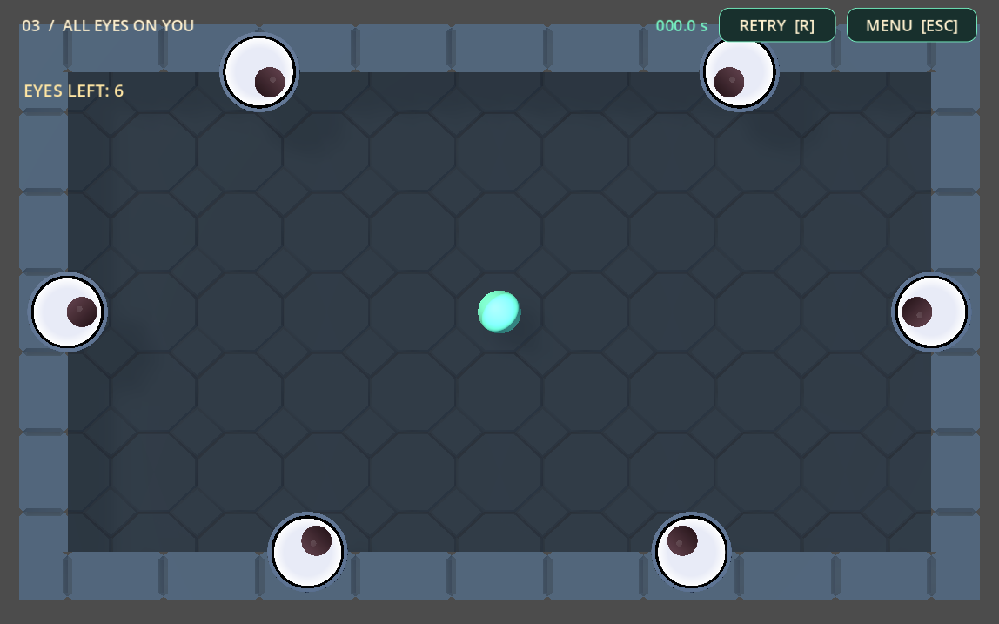
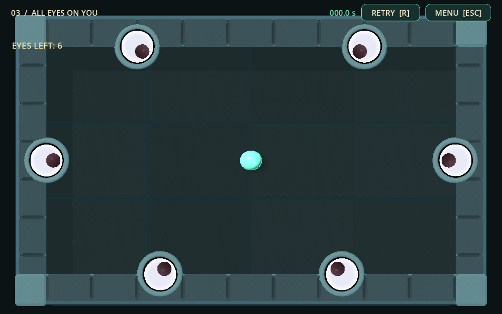

# Toy dungeon board art pass

The arena now has a stepped stone frame, stronger corner blocks, a quiet slab
floor, faceted eye mounts, and a glossy mint blob with a close contact shadow.
The playfield remains an uncluttered 18 by 10 arcade board.

## Files changed by this pass

- `stop_staring/scenes/main.tscn`: blob material/visual scale/contact shadow
  and minor camera framing changes. No collision edits.
- `stop_staring/scenes/eye.tscn`: the flat rim becomes a shallow stone collar;
  the existing sprites and hit origin are retained.
- `stop_staring/scripts/kaykit_arena_visuals.gd`: floor, frame and lighting.
- `stop_staring/assets/environment/kaykit/floor_foundation_allsides.gltf`,
  `.bin` and generated `.gltf.import`; updated provenance README.
- `stop_staring/assets/environment/support/beveled_block.tres`,
  `eye_stone_collar.tres` and README.
- `stop_staring/art/environment/blob_contact_shadow.svg` and generated import
  metadata.
- `tools/build_board_supports.gd`: reproducible source for the two support meshes.
- This report, `before.png`, and `after.png`.

Only three existing source files changed relative to the start-of-pass snapshot:
the two scenes and the arena visual script. Player control, eye logic, existing
blob deformation, time effects, feedback, level navigation and UI scripts are
byte-identical to that snapshot. The dirty working tree's earlier work was
preserved.

## Assets, meshes and materials

The current KayKit models are `wall.gltf` and `floor_foundation_allsides.gltf`.
Both use the already-present shared `dungeon_texture.png`. This pass added only
the foundation model and its `.bin` buffer. The previous octagonal
`floor_tile_large` files remain as the earlier experiment's source assets,
but are not used by the new skin. Corner/pillar candidates were inspected;
simple supporting geometry gave a cleaner board silhouette.

Blender was not used. Two small static meshes were generated using Godot:
a beveled unit block (44 triangles) and a 24-sided eye collar (288 triangles).
The frame instances the block as a plinth, four inner lips, four lower outer
steps and four substantial corner caps. The imported wall tops are 20% wider,
extending outward while retaining the original arena-facing boundary.
The completed environment has 12 floor slabs, 16 KayKit wall segments and
13 frame-support instances. None has a collision object or collision shape.

The foundation tops become large 4.5 by 3.33 slabs with narrow 0.035 seams and
at most 3% deterministic tint variation. Their gray palette is retained with
a muted stone tint, roughness 0.94 and low specular response. Frame supports
use related slate materials, roughness 0.90; collars use roughness 0.88.

The blob retains its mint color, sphere mesh and all existing squash/stretch
logic. Only its inner mesh is slightly softened to scale (1.08,0.96,0.94).
Its material now has roughness 0.28, a modest rim and clearcoat highlight.
A radial-gradient contact shadow follows the physics body on the floor.
The collider remains an unscaled 0.45-radius sphere. No idle animation or rig
was added.

Eye origins, rotation, white-face size, tracking limits and hit tests are
unchanged. The collar is shallow and faceted rather than a detailed socket.
Long actor cast shadows are disabled so the oversized eyes read as mounted
instead of floating. Existing socket and pop behavior remain.

## Camera and lighting

The camera stays frontal and orthographic. Size changes from 13 to 13.8,
its center shifts up by 0.15, and the far plane becomes 40. The extra margin
keeps the complete 20.8 by 12.8 visual frame visible. No camera tilt remains.
Cursor projection to the XY gameplay plane was checked explicitly.

A soft colored ambient environment complements the two existing directional
lights. Their directions remain unchanged. The key is slightly warm at energy
1.05; the cool fill is 0.24. Key shadows use opacity 0.35 and blur 1.8 with a
single orthogonal shadow region for the small board. The background is dark
teal, giving the physical frame a clear silhouette. No glow, fog, SSAO, heavy
post-processing or custom shaders were added.

Disabling, hiding or removing `Arena/KayKitVisuals` restores the original
graybox floor/walls and environment/light settings. The separate eye and blob
art edits remain, and can be reverted independently in their scene resources.

## Validation

- Existing `launch_controls`, `ricochets`, `wall_eye`, `blob_visual`,
  `scene_transitions`, `impact_polish` and `menu_levels` suites passed.
- Compared all four StaticBody3D transforms, box sizes, collider transforms,
  layer/mask settings, player collider and eye origin against the start-of-pass
  scene snapshot. They are unchanged.
- Confirmed no physics objects or collision shapes under the art layer.
- Compared all positions and velocities for 360 physics frames with the skin
  disabled/enabled. Every frame matched exactly.
- Projected all eight AABB corners of every environment mesh through the final
  camera: the complete frame stays on screen.
- Verified camera-to-plane round trips at the center and several arena points.
- Exercised native runtime mouse press/drag/release: the blob launched and
  reflected from the original walls. Then reset room 3 for review.
- Captured room 3 with six active eyes, centered stationary blob, timer zero
  and approximately matching framing at 1148 by 717 before and after.
- `git diff --check` passed. Headless Godot emits its existing macOS certificate
  lookup error in the sandbox; successful runs contain no project script errors.

## Remaining visual limits

The frontal view intentionally reveals bevels and stepped silhouettes more
than tall side faces. Further camera tilt would require checking the eyes'
transparent sprite sorting. The floor is deliberately regular; a future
art decision could introduce a little slab-shape variation while retaining
the same low contrast. Native human playtesting should judge the new framing
and blob highlight during sustained fast ricochets. No additional work was
started after this pass.

Before:

After:

