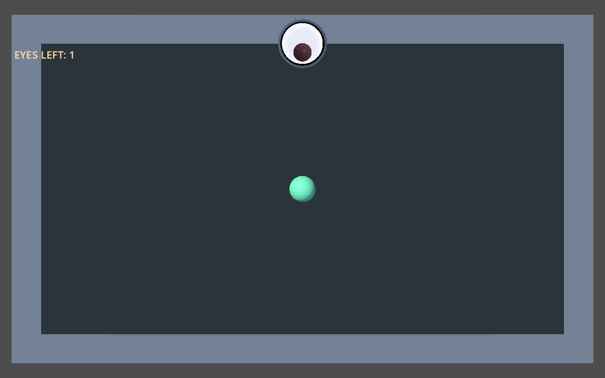
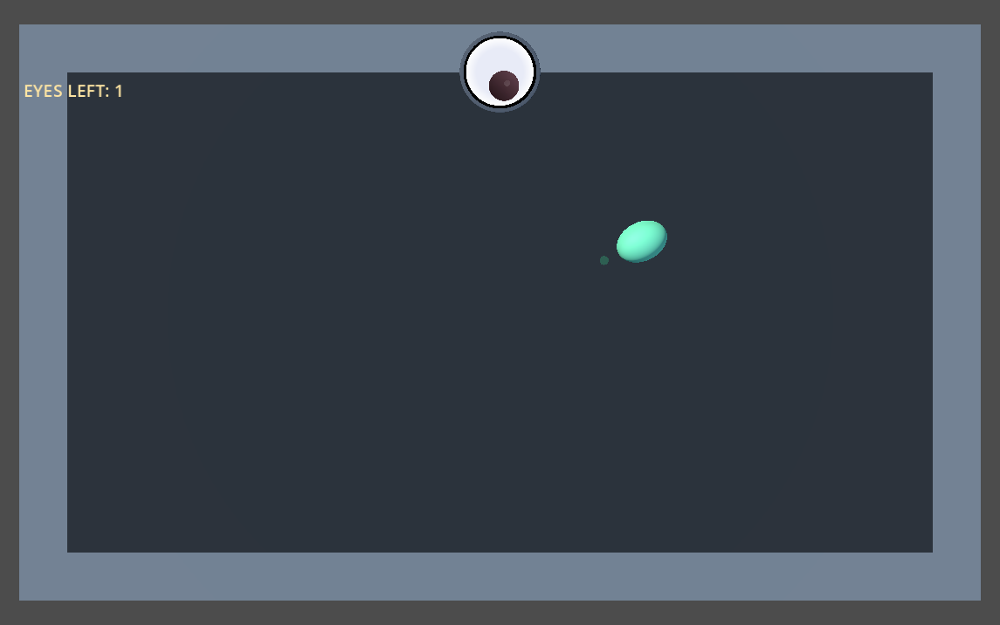
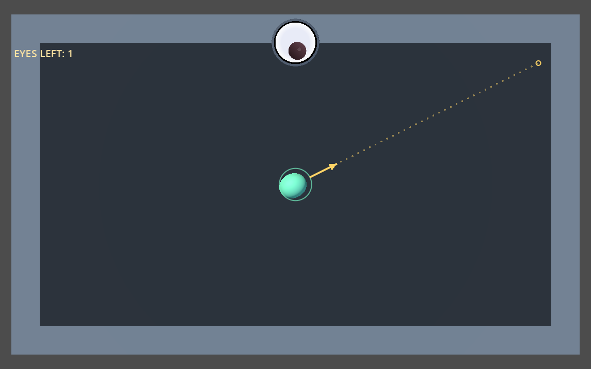
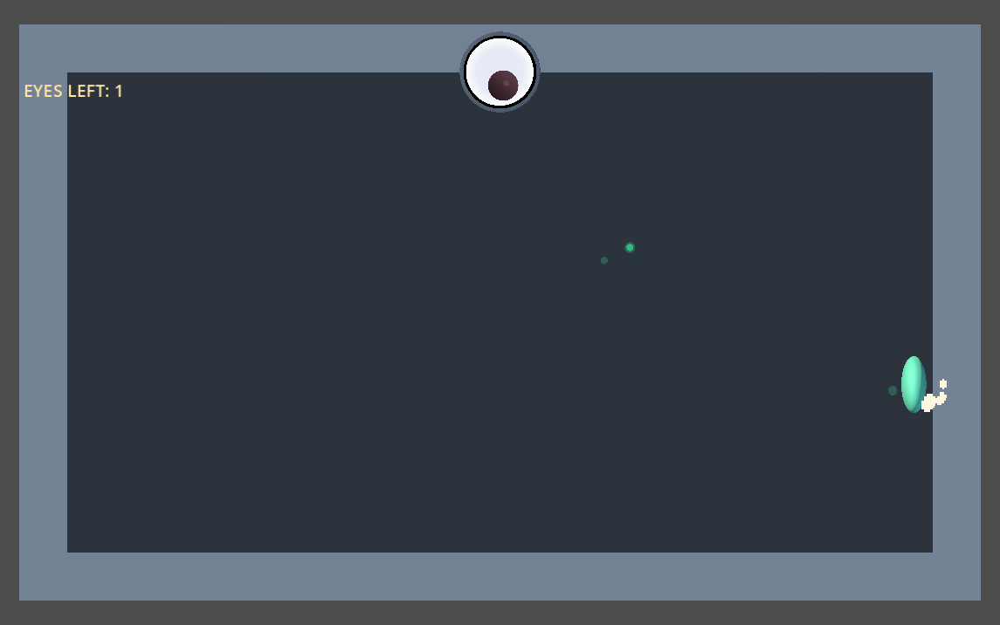

# Procedural blob polish — issue #8

The mint sphere now has visual-only speed stretch, wall-impact squash,
aim anticipation, a release compression pulse and a faint motion trail.
This implements the blob/trail portion of [issue #8](https://github.com/kickflip-games/stop-staring-trijam393/issues/8).

## Inspection and hierarchy

The original player is `Player` in `stop_staring/scenes/main.tscn`, driven by
`stop_staring/scripts/blob.gd`. Movement is in XY; `velocity.z` and
`position.z` are constrained to zero. Both the visible sphere and collision
sphere have radius 0.45. The body uses swept `move_and_collide`, reflects
incoming velocity with `velocity.bounce(normal) * bounce_retention`, and
consumes the remaining movement time. Existing damping, settling and
ricochet calculations are unchanged.

While aiming, `drag_vector` stores the capped launch direction/strength.
`get_launch_velocity()` maps that drag to 4–18 units/second. Release still
assigns the result directly to `velocity`; it now also emits `launched`
after that assignment, with no animation wait.

```text
Player (CharacterBody3D, unit scale)
├── Collision (original SphereShape3D, radius 0.45, unit scale)
├── VisualPivot (new visual script)
│   └── Mesh (original SphereMesh/material)
├── MotionTrail (12 world-space CPU particles)
├── WallHitAudio
└── StretchAudio
```

The mesh moved from `Player/Mesh` to `Player/VisualPivot/Mesh`. Only
`VisualPivot` rotates, translates slightly and scales. The trail is a
sibling, so visual squash never deforms its emitter or the collision shape.

## Inspector tuning

Select `Player/VisualPivot` to tune these exported values:

| Parameter | Default | Meaning |
| --- | ---: | --- |
| `stretch_start_speed` | 3.0 | Speed where stretch starts |
| `stretch_full_speed` | 18.0 | Speed where stretch reaches its maximum |
| `max_stretch_amount` | 0.22 | Maximum local-X stretch: scale 1.22 |
| `perpendicular_squash_amount` | 0.10 | Maximum Y/Z compression: scale 0.90 |
| `smoothing_speed` | 18.0 | Exponential shape/orientation response rate, per second |
| `impact_squash_amount` | 0.42 | Contact-axis compression: scale 0.58 |
| `impact_expansion_amount` | 0.32 | Perpendicular expansion: scale 1.32 |
| `impact_duration` | 0.08 s | Impact pulse length, including a 0.02 s peak |
| `aim_stretch_amount` | 0.10 | Full-strength anticipation stretch |
| `aim_pullback_distance` | 0.10 | Maximum visual offset opposite launch, in world units |
| `launch_squash_amount` | 0.14 | Release compression: scale 0.86 along launch |
| `launch_duration` | 0.04 s | Release pulse length |
| `trail_start_speed` | 6.0 | Speed where trail strength starts rising |
| `trail_full_speed` | 18.0 | Speed where trail reaches full strength |
| `trail_max_opacity` | 0.25 | Maximum particle opacity |

`Player/MotionTrail` also exposes its built-in particle settings: 12
particles, 0.14 s lifetime, 0.14 radius mesh, zero gravity and zero particle
velocity. A size curve shrinks each particle to zero. No external art or
shader was added.

## Visual response

Local X is the stretch/compression axis. `atan2(velocity.y, velocity.x)`
turns planar travel into a Z rotation. Equivalent ellipsoid orientations
are compared modulo PI, then smoothed with `1 - exp(-smoothing_speed * delta)`;
a reversal does not cause an unnecessary half turn. Speed strength uses
`smoothstep` between the two speed thresholds.

The visual script subscribes to the existing `wall_contact` signal, which
provides every incoming collision normal before the physics reflection.
The pulse immediately aligns local X with that normal, compresses the
mesh, and shifts only the visual toward the wall by the lost radius.
It holds the peak briefly, then recovers into the current velocity shape.
One resettable impact timer handles repeated contacts; pulses do not stack.

Aim reads the existing drag and launch velocity. Stronger aim slightly
lengthens and pulls back the visual opposite the impending launch.
The new `launched` signal compresses it immediately for 0.04 s while the
body moves normally, then it recovers into speed stretch. Canceled aim
returns smoothly to the current movement shape.

The trail emits behind the player in world space. Speed raises opacity;
below its threshold it stops emitting and existing particles disappear
within 0.14 s. It uses Godot's compatibility renderer and CPU particles.

## Validation and captures

Tested with Godot 4.8.dev6 on the native OpenGL compatibility renderer.
The new visual checks passed both headless and in a native window. They
cover rest, diagonal stretch, smooth turns, actual wall impacts, outgoing
bounce recovery, 120 rapid corner impacts, aim/cancel, immediate launch,
trail emission and unit-scale/unrotated physics transforms.

A temporary pre-change fixture recorded 3,780 position/velocity samples
across 30/60/120 Hz, three starting positions and three initial velocities.
The same samples after implementation agreed to within 0.000001; the
largest observed difference was about 5e-14 from JSON serialization.

Existing `launch_controls.gd`, `ricochets.gd`, `wall_eye.gd`,
`menu_levels.gd` and `scene_transitions.gd` checks passed. Live inspection
also confirmed that the player and its collision shape remain at unit
scale with zero rotation. `git diff --check` passed.

Run from the repository with your Godot executable:

```bash
godot --headless --path stop_staring --script res://tests/blob_visual.gd
godot --path stop_staring --script res://tests/blob_visual.gd
```

The native test saves six screenshots to `/tmp/stop-staring-blob-*.png`.
Its captures freeze the tested visual moments for inspection; the launch
and bounce timing checks run before capture. A baseline screenshot was
captured from the running game before source edits.

| Before | Fast movement and trail |
| --- | --- |
|  |  |

| Aim anticipation | Wall impact |
| --- | --- |
|  |  |

Other captures: [rest](after-rest.png), [release](after-release.png),
[post-bounce](after-bounce.png).

After playing, tune impact duration/strength first for readability, then
speed stretch and trail opacity. Defaults are deliberately restrained;
subjective feel still needs your playtest, especially at different frame
rates and window sizes.

## Files for this change

- `stop_staring/scenes/main.tscn`: pivot hierarchy and built-in trail resources.
- `stop_staring/scripts/blob.gd`: launch signal and immediate emission only.
- `stop_staring/scripts/blob_visual.gd` and `.uid`: procedural presentation.
- `stop_staring/tests/blob_visual.gd` and `.uid`: focused checks/captures.
- `docs/blob_polish/`: this report and seven before/after screenshots.
