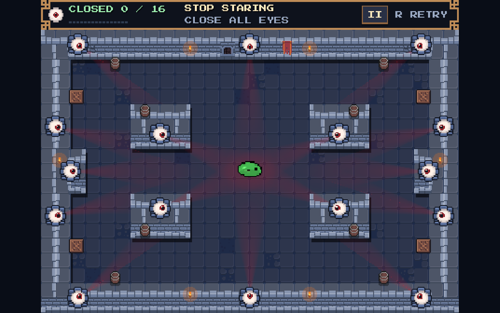
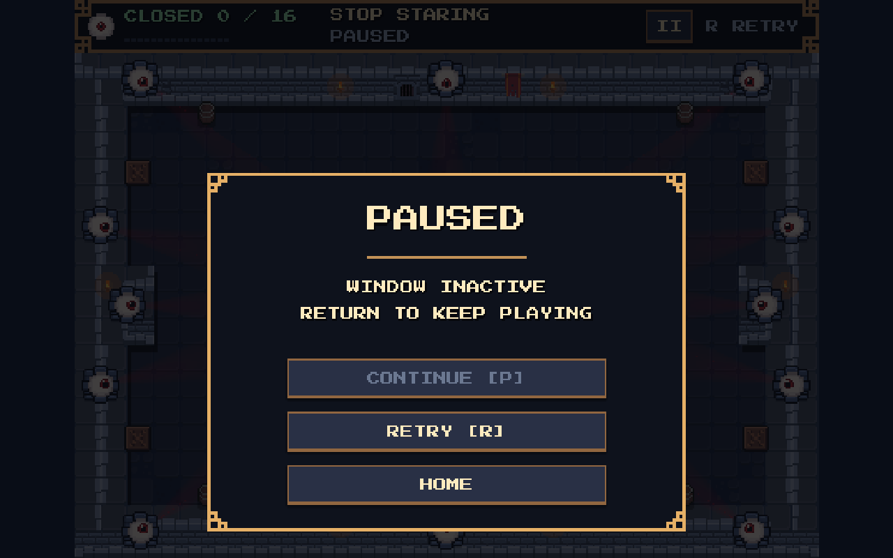
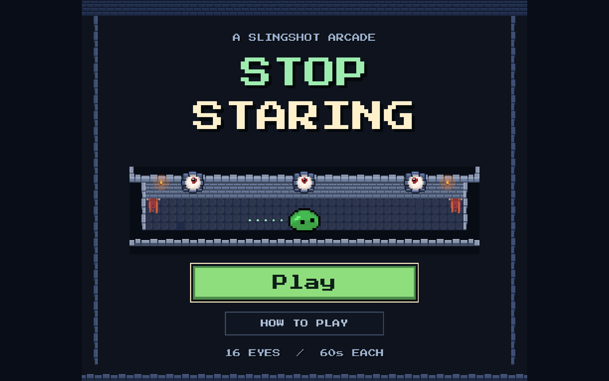

# Fullscreen aspect fit

The game starts fullscreen. F11 switches between fullscreen and windowed mode
from either the home screen or gameplay. Each complete view scales uniformly to
fill the available width or height, with centered bars only where the screen's
aspect ratio differs. The menu retains its 448 × 384 canvas; gameplay retains
448 × 336, its fixed camera, nearest filtering, layout and HUD.

Resizing and fullscreen switching cancel an unfinished aim gesture. An old
mouse release cannot cause a launch, and movement velocity is preserved.

Native Godot 4.8.dev6 checks passed:

- Fullscreen/aspect/input fixture: 65 checks, including native startup mode,
  F11 in both scenes, widescreen and portrait window fits, active-aim cancellation,
  and fullscreen pointer launch speed/direction.
- Gameplay regression: 2472 checks.
- Home screen: 45 checks, including guide input and Home/Play scene transitions.
- HUD/pause/retry: 53 checks.
- Headless aspect-fit fixture: 32 checks.

The fixture waits for the macOS startup fullscreen transition before changing
mode. Existing ObjectDB teardown warnings remain outside this change.

Run `res://experiments/pixel_pivot/tests/fullscreen_scaling.gd` with a native
Godot window to repeat the fullscreen checks; headless runs cover aspect fit only.

