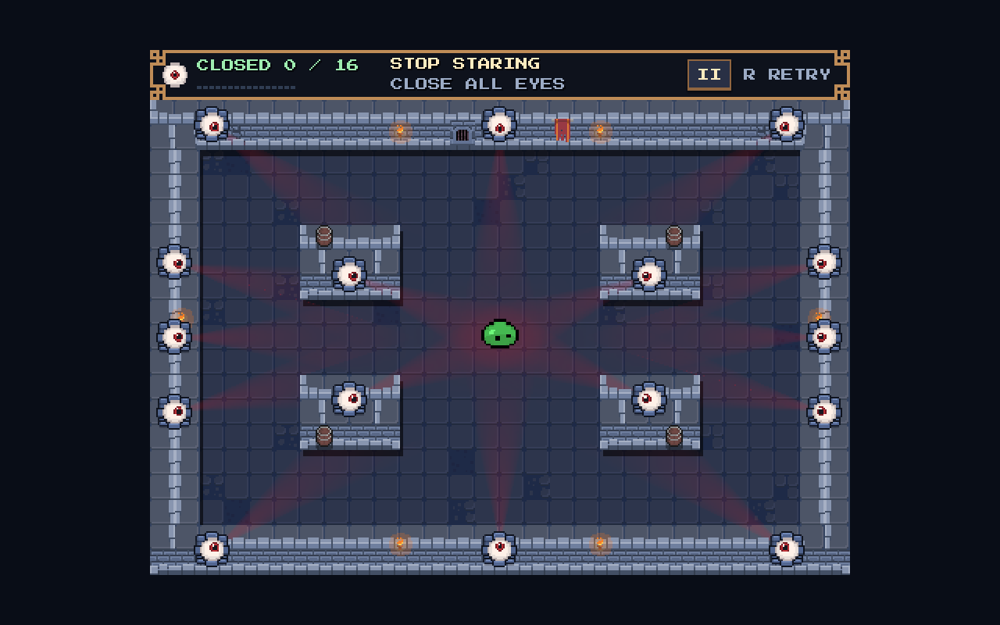

# Eye gaze cones

Open eyes project translucent red cones in the direction their pupils track.
Closing an eye removes its cone on the hit frame; its independent reopen
restores the cone with the pupil's immediate lock onto the slime. The cones
freeze on pause and disappear on a completed clear.

The effect is visual. It does not change eye contact, timers, scoring or
slime movement. Existing wall and prop colliders clip the fan; an embedded
eye cannot shine through the back of its supporting surface.

## Native captures

These matched 1280 × 800 captures use the current four-island room at 2×
integer scale. The `before_*` images disable only the new gaze effect in
the same scene; the `after_*` images enable it. Torches and idle sprites
continue animating normally.

| State | Before | With cones |
|---|---|---|
| Slime at spawn | [Room](before_room.png) | [Room](after_room.png) |
| Slime near top | [Tracking](before_tracking.png) | [Tracking](after_tracking.png) |
| Two eyes closed | [Closed](before_closed.png) | [Closed](after_closed.png) |



## Tuning and implementation

`stop_staring/experiments/pixel_pivot/eye.gd` exposes `gaze_enabled`,
`gaze_length` (160 pixels), `gaze_half_angle_degrees` (12°) and
`gaze_opacity` (0.18) on each eye. It installs `gaze_cone.gd` at runtime,
so room rebuilding keeps the effect.

The fan fades at its sides and along its length. Pixel-rounded geometry
stays below eyes, props and slime. Twenty-five rays refresh at 30 Hz using
the existing real-time clock; closing and reopening force an immediate
refresh. Each cone submits its triangles in one cached draw command using
Godot's [triangle-array drawing API](https://docs.godotengine.org/en/stable/classes/class_renderingserver.html#class-renderingserver-method-canvas-item-add-triangle-array).

## Validation

| Fixture | Mode | Result |
|---|---|---|
| `gaze_cones.gd` | Headless | 86 checks, 0 failures |
| `gaze_cones.gd` | Native | 89 checks, 0 failures |
| `regression.gd` | Headless | 2,428 checks, 0 failures |
| `independent_eyes.gd` | Headless | 230 checks, 0 failures |

Godot still reports two audio ObjectDB instances at shutdown in the gaze,
regression and independent-eye runs. No gaze script or rendering errors
were observed; the fixture waits for stopped impact audio before teardown.

The gaze fixture checks actual solid-wall and barrel-sized collider
occlusion, pupil alignment, closure, independent reopen, pause, final
clear, retry and unchanged gameplay state. Native captures were inspected
in the Compatibility renderer. These checks do not establish performance
on browser or touch devices.

Run from the repository root with the executable described in the gameplay
README:

```bash
"$GODOT_BIN" --headless --path stop_staring --script res://experiments/pixel_pivot/tests/gaze_cones.gd
"$GODOT_BIN" --path stop_staring --script res://experiments/pixel_pivot/tests/gaze_cones.gd -- --baseline
"$GODOT_BIN" --path stop_staring --script res://experiments/pixel_pivot/tests/gaze_cones.gd
```
