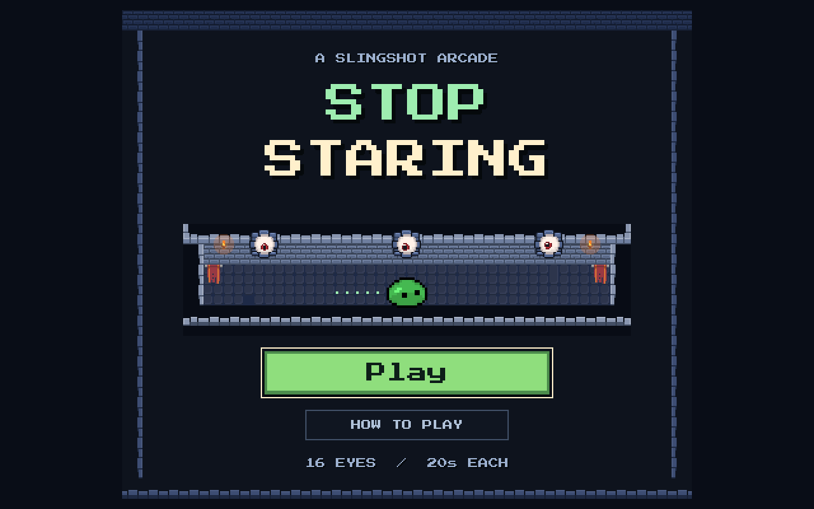

# Pixel arcade home screen

The project opens `res://ui/home_screen.tscn`. Play enters the existing
dungeon room. How to Play opens a short controls guide; Got It or Escape
returns to the menu. The pause and clear panels include a Home button.
Enter activates the focused button; Tab and the arrow keys navigate.

## Appearance and existing assets

The layout uses the game's 448 × 384 logical viewport with centered integer
scaling and nearest filtering. The title, buttons and guide use the existing
Press Start 2P font. No new image assets or fonts were downloaded or created.

- `stop_staring/ui/home_screen.tscn`: editable title, buttons, guide,
  animated slime and torches, and the viewport layout.
- `stop_staring/ui/home_art.gd`: stone trim and dungeon vignette using
  the same 16 × 16 dungeon atlas regions as the room, plus the existing
  socket, eyeball and pupil layers. The pupils follow the pointer.
- `stop_staring/ui/home_theme.tres`: square mint Play button, slate
  secondary button, ivory focus outline and guide panel.
- `stop_staring/ui/home_screen.gd`: integer scaling, modal focus and
  deferred entry into the game.
- `stop_staring/experiments/pixel_pivot/hud.gd` and
  `stop_staring/ui/retro_hud.tscn`: Home navigation from pause and clear.

## Native captures

The first two images are matched 1102 × 689 captures from the editor's
embedded running game. The original project booted directly into the room.
The remaining images are standalone native Godot captures.

| Capture | Viewport | Purpose |
|---|---|---|
| [Before](before.png) | 1102 × 689 | Startup before edits |
| [After](after.png) | 1102 × 689 | Home screen in the same embedded viewport |
| [Home at 1×](home_1x.png) | 448 × 384 | Native pixel size |
| [Home at 2×](home_2x.png) | 1280 × 800 | Default desktop window |
| [Home at 3×](home_3x.png) | 1440 × 1200 | Larger integer scale |
| [Controls guide](guide_2x.png) | 1280 × 800 | Readable guide and modal layout |
| [Pause with Home](paused_with_home.png) | 1280 × 800 | Return navigation |



## Verification

Validated with Godot 4.8.dev6 and the existing Compatibility renderer.
The native menu fixture routes actual mouse/key events through the root
viewport. It checks the controls overlay, focus restoration, Escape and
Enter, pointer routing at each scale, entry without an accidental launch,
Home from pause and clear, and window/time-scale restoration.

```bash
GODOT_BIN='/Users/avi/Library/Application Support/Godot/app_userdata/Godots/versions/Godot_v4_8-dev6_macos_universal/Godot.app/Contents/MacOS/Godot'
"$GODOT_BIN" --path stop_staring --script res://experiments/pixel_pivot/tests/home_screen.gd
"$GODOT_BIN" --headless --path stop_staring --script res://experiments/pixel_pivot/tests/regression.gd
"$GODOT_BIN" --headless --path stop_staring --script res://experiments/pixel_pivot/tests/retro_ui.gd
"$GODOT_BIN" --headless --path stop_staring --script res://experiments/pixel_pivot/tests/independent_eyes.gd
```

Results: 44 native home-screen checks, 2323 gameplay checks, 44 HUD checks,
and 331 stare-cycle checks; zero failures and no runtime errors in these
final runs. The native fixture refreshes the standalone captures.
