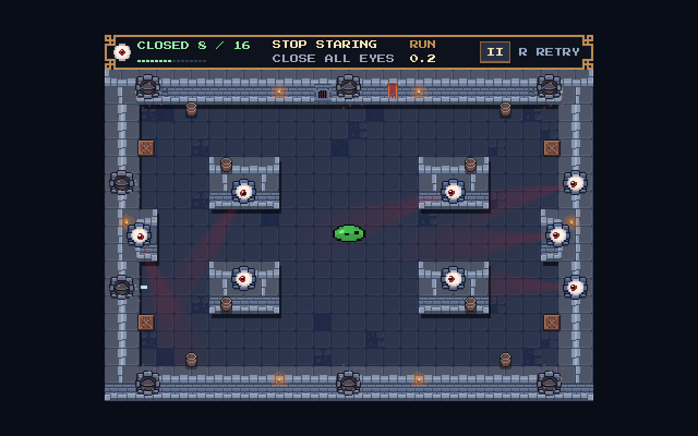
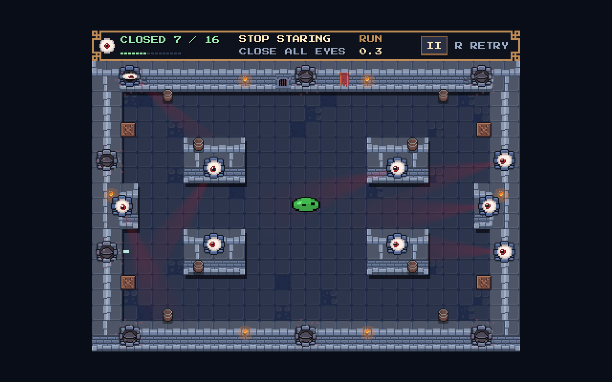

# Independent eye timers

The default closed duration is now **60 seconds**, increased from 20 seconds to make routing easier. The original implementation validation below is retained; the full-minute tuning checks are recorded at the end.

The shared stare countdown is removed. Each of the existing sixteen wall
eyes owns a **60.0-second closed duration**, using real elapsed time. Only
that eye reopens when its duration expires. The win condition is **all eyes
CLOSED at the same time**. The separate `RUN` clock starts on the first
launch, continues through reopens, and freezes on clear for time scoring.
It does not trigger gameplay expiry.




## Behavior and tuning

- `eye.gd` retains `State.OPEN` / `State.CLOSED`. An accepted OPEN contact
  sets `closed_remaining = closed_duration` and counts once. A CLOSED
  contact does not refresh, score or trigger eye feedback; the existing
  wall bounce continues.
- Each eye's final **3.0 seconds** produce a subtle 1px lateral twitch and
  eyelid rotation. Only the local visual warns; there are no eye numbers,
  collective warning phase, heartbeat or wake flash.
- Expiry cancels the hit squash and warning transforms synchronously,
  restores the socket, locks the pupil onto the player and snaps the
  eyeball open over **0.1 seconds**. `_pop_age` and `_snap_age` have no
  delayed Tween callbacks. A rehit during the snap cancels it cleanly.
- `arena.advance_time()` supplies uncapped monotonic wall time to the eyes,
  including 0.25x aiming and zero-scale hit-stop. Explicit pause and focus
  loss exclude their inactive intervals. This does not add another
  `Engine.time_scale` writer.
- Every physical hit settles older eye deadlines before checking the
  simultaneous closed count. A final hit after an older eye expired cannot
  produce a false win. Completing the set stops every eye timer and uses
  the current final-impact/clear-panel flow. Retry resets every eye timer,
  both animation ages, pupil offset, run clock and the existing player state.
- HUD shows **`CLOSED n / 16`**, filling pips as eyes close. The adjacent
  time slot shows overall `RUN` time. The pause and Home controls retain
  their layout; the guide text now explains the independent timers.

The unchanged socket is 24px wide with a 12px visible radius. Its contact
radius increased from 14px to **15px**, giving 25% slack beyond that visual
radius. Surface-contact tolerance increased from 0.15px to **0.5px**.
Supporting-wall matching, normal validation and minimum impact speed remain
in place. Actual swept impacts at ±14.75px now close an eye. A 15.1px miss
still rejects. No separate physical eye collider was added, so wall
collision and ricochet normals remain authoritative.

Tune `closed_duration`, `reopen_warning_duration`, `reopen_snap_duration`
and `hit_radius` on the existing eye scene/instances. Human routing balance
at 60 seconds still needs playtesting.

## Changed files

| File | Change |
|---|---|
| `stop_staring/experiments/pixel_pivot/eye.gd` | Independent timer, local warning/snap, reopening event and generous contacts |
| `stop_staring/experiments/pixel_pivot/arena.gd` | Removes global cycle, advances eye durations, counts transitions and stops timers on simultaneous completion |
| `stop_staring/experiments/pixel_pivot/hud.gd` | Closed/total count and score clock; removes shared countdown/failure feedback |
| `stop_staring/experiments/pixel_pivot/effects.gd` | Removes global heartbeat and collective wake hooks; retains launch, wall, eye-hit and win effects |
| `stop_staring/ui/retro_hud.tscn` | Fits closed/total text and relabels the time slot RUN |
| `stop_staring/ui/home_screen.tscn` | Updates goal/footer instructions only |
| `tests/independent_eyes.gd` | Focused independent-deadline, physics, boundary and reset validation plus captures |
| `tests/retro_ui.gd`, `tests/juice.gd`, `tests/record_juice.gd` | Current eye rule and HUD expectations |
| `tests/regression.gd`, `tests/home_screen.gd` | Wait for the existing local effect warmup before Play |
| Root/gameplay READMEs and this report | Current rules and validation |

`preserved_sources.json` verifies that the player, camera, presentation,
layout, arena/viewport scenes and slime/eye art scenes match the saved local
baseline. Music/clock and home warmup changes made separately in the local
checkout were preserved. No level geometry, art asset, movement or camera
code was changed by this task.

## Validation

Godot 4.8.dev6 / Compatibility; native rendering on Apple M4 Pro.

| Fixture | Result |
|---|---|
| Movement, input, all physical targets, collision reachability | 2366 native checks, 0 failures |
| Independent eye timers and local feedback | 243 native checks, 0 failures |
| HUD, pause/clear panels and integer scaling | 53 native checks, 0 failures |
| Home/guide/Play and scene return | 45 native checks, 0 failures |
| Retained launch/wall/eye/win feedback | 83 headless checks, 0 failures |

The native independent-eye test explicitly performs:

hit A → aim at 0.25x → hit B later → A alone reopens while the player flies
→ immediately hit A again → B retains its existing deadline.

Other checks cover closed-eye normal bounces with no refresh or hit-stop,
individual warnings, real time under aim/hit-stop, pause/focus exclusion,
uncapped long frames, an expired older eye immediately before a final hit,
all timers stopped on win, twenty rapid squash/reopen/rehit/retry sequences,
and R during aiming/hit-stop. The physical regression covers the unchanged
five-pixel player circle, maximum-speed bank shots and every supporting wall.
Short fixture durations accelerate timed checks; saved eye defaults stay 60s.

Native captures: `open.png`, `eight_closed.png`, `one_warning.png` and
`one_reopens.png`. Contact fixtures position the player near eyes to test
collision rules; these are not timed human clears. The current Godot/audio
setup reports MP3 stream/playback cleanup warnings at process exit; the
final gameplay assertions pass. This task did not alter music assets or
its autoload.

```bash
GODOT_BIN='/Users/avi/Library/Application Support/Godot/app_userdata/Godots/versions/Godot_v4_8-dev6_macos_universal/Godot.app/Contents/MacOS/Godot'
"$GODOT_BIN" --path stop_staring --script res://experiments/pixel_pivot/tests/independent_eyes.gd
"$GODOT_BIN" --headless --path stop_staring --script res://experiments/pixel_pivot/tests/regression.gd
"$GODOT_BIN" --path stop_staring --script res://experiments/pixel_pivot/tests/retro_ui.gd
```

Earlier stare-cycle and feedback galleries retain historical captures of
the shared 35-second rule. This report and the gameplay README describe the
current independent-eye rule.

## Full-minute tuning

The eye default is 60.0 seconds, with the existing final-three-second warning and independent real-time expiry. Menu/footer instructions now say 60s. The updated fixture checks that an eye remains closed at 57.2 elapsed seconds, then reopens at its deadline while later eyes retain their own time; accelerated fixture clocks avoid waiting a full minute during testing.

Validation: 231 headless and 244 native independent-eye checks, plus 40 headless home/menu checks, all with zero failures. Live slow-motion expiry, no refresh on closed hits, simultaneous win and retry remain covered. Movement, layout, camera and HUD logic are unchanged.
