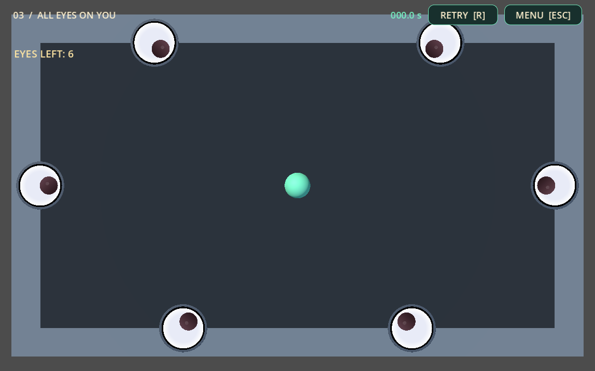

# KayKit arena visual experiment

The experiment keeps the arena as a small arcade board: a muted slate floor,
chunky beveled boundary blocks, the green blob, and the existing giant eyes.
There are no props, extra rooms, or dungeon traversal elements.

## Inspection and implementation

The gameplay scene is `stop_staring/scenes/main.tscn`. Its arena uses XY with
Z fixed at zero for movement. The playable rectangle remains 18 by 10 units.
The top/bottom box colliders are 20 by 1 by 2, centered at Y=+/-5.5; the
left/right boxes are 1 by 10 by 2, centered at X=+/-9.5. All four StaticBody3D
nodes, collision shapes, masks, transforms and wall paths are preserved.
The player's original sphere collider retains its 0.45 radius.

`Arena/KayKitVisuals` owns the new art. Its script derives the floor bounds and
wall placements from those existing collider positions and sizes. The floor
uses 15 instances of `floor_tile_large.gltf`; the boundary uses 16 instances
of `wall.gltf`. Both models, their two `.bin` buffers, one shared
`dungeon_texture.png`, and `License.txt` are the only copied pack files.
The original glTF files and texture are byte-identical to the local source.
Godot adds three `.import` sidecars.

The source floor is 4 by 4 with a shallow beveled surface. It is fitted to a
5 by 3 grid, with its highest surface at the original backdrop surface Z=-1.
The source wall is 4 wide, 4 tall and 1 deep. Rotated into the board's plane,
it fits the original boundary envelope, with the cap at Z=1.
Corner/pillar candidates were inspected but not copied.

The orthographic camera remains at (0,0,20), with its original rotation and
size 13. No camera adjustment was made. The entire arena remains visible.
The two existing directional lights keep their directions, colors and energy.
The skin enables subtle key-light shadows (opacity 0.22, blur 2, distance 30),
and restores the original light settings when disabled, hidden or removed.
The imported palette materials are tinted dark slate for the floor and muted
blue-gray for the walls, with roughness 0.95. No shaders or post-processing
were added. There is no new WorldEnvironment.

No eye position, depth, scale, tracking or collision adjustment was made by
this experiment. The existing Z=1.06 puts the clean googly eyes in front of
the wall caps. Movement, aiming, bounce and eye logic were not edited.

## Verification

- Captured the running graybox before editing, and the running skin after,
  at 1148 by 717 with room 3, six unpopped eyes, the stationary centered blob,
  and the same camera. The timer was held at zero only for comparison captures.
- Compared authored wall colliders, player collider, camera and eye transforms
  against the captured pre-edit scene. All match.
- Confirmed the 31 imported mesh instances add no CollisionObject3D or
  CollisionShape3D nodes.
- Compared positions and velocities for 360 manually advanced physics frames
  with the skin disabled and enabled, starting at velocity (18,7.2,0).
  The damped ricochet traces were identical on every frame.
- Verified disabling, hiding, showing and removing the art layer restores the
  expected original floor/walls and lighting without changing physics.
- Launched the native running game and exercised mouse press, drag and release;
  the blob moved and reflected from the original side/top boundaries.
- Existing launch-controls, ricochet, wall-eye, blob-visual and scene-transition
  suites passed after implementation. Headless Godot emitted the same macOS
  certificate lookup error seen during baseline checks; no project script
  errors remain in those successful runs.

Separate feedback/polish edits appeared in the shared checkout during this
experiment. They were preserved. A temporary parse error in that work was
fixed concurrently before the final successful checks; this experiment did
not edit those scripts. Its gameplay preservation claim concerns the KayKit
layer and the original collision/camera/eye-placement contracts.

## Files from this experiment

- `stop_staring/scenes/main.tscn`: one script resource and `Arena/KayKitVisuals`.
- `stop_staring/scripts/kaykit_arena_visuals.gd` and generated `.uid`.
- `stop_staring/assets/environment/kaykit/`: the six supplied files above,
  three generated import sidecars, and provenance README.
- This report and `docs/kaykit-before.png`, `docs/kaykit-after.png`.

Disable the skin's exported `enabled` property to compare graybox and KayKit
on the next run. Hiding it also works at runtime. Removing `KayKitVisuals`
restores the original authored meshes without a gameplay refactor.
The pieces are constructed at runtime; the editor's static viewport retains
the graybox, while running the arena shows the skin.

## Visual assessment

The restrained subset fits the experiment: the boundary feels like a chunky
board frame, and the bright blob and white eyes stay prominent. The floor has
a visible repeated stone pattern, but its dark tint keeps it subordinate to
the action. The unchanged straight-on camera emphasizes cap bevels rather
than full wall facades. The result reads as an arcade diorama. Human play feel
and personal art preference remain subjective; no further art work was done.

Before:

After:

