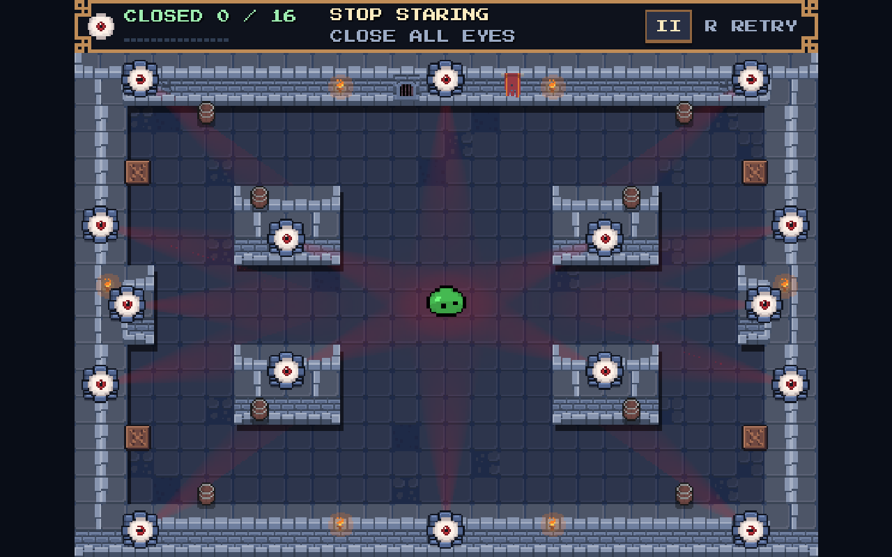
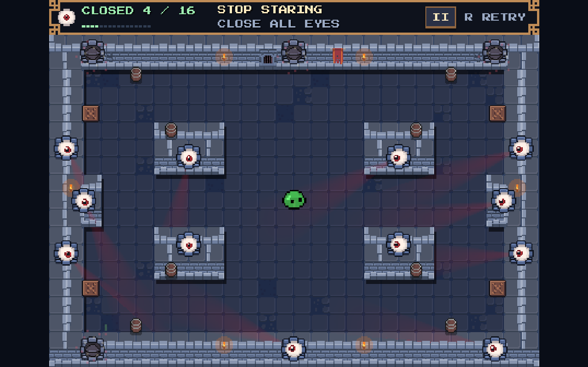

# 2D game captures

The level screenshots now show the [current quadrant arena](../quadrant_arena/README.md): four solid islands, sixteen eyes and a 448 × 336 game view. That report includes matched before/after captures and a current movement clip. The checkpoint notes and older movement recording below describe the earlier 2D pivot.

Press **F5** to run the default 2D game, or open
`res://experiments/pixel_pivot/pixel_pivot.tscn` and press **F6**.
Controls, atlas coordinates, tuning and runnable commands are documented in
`stop_staring/experiments/pixel_pivot/README.md`.

Captures were rendered with the installed Godot 4.8.dev6 Compatibility
runtime. The complete 448 × 336 game viewport now scales proportionally
to fill the window; see [fullscreen captures](../fullscreen/README.md).

## Single-room level

The current complete room has sixteen eyes, four symmetric quadrant islands,
a slate floor, a banner, torches, a gate, eight barrels and four scattered crates:

After four target hits, closed eyelids remain on solid walls:

## Movement

[Native movement recording](movement.mp4) — scripted native
mouse events, live CharacterBody2D movement, re-aiming, bank shots and
eye pops in the single room. Captured by Godot MovieWriter at 60 fps and
converted from its AVI to H.264/AAC MP4. No player teleporting or manual
movement integration is used in this recording. The 6.5-second clip comes
from an isolated copy of the room before the parallel HUD restyle. Its
scripted run produced four launches, twelve bounces and two eye pops. The
screenshots above include the newer HUD.

## Validation

After repository cleanup, the focused regression fixture passed **2468 assertions**
in headless Godot, including 720 maximum-speed sweep steps across four
diagonal directions. It checks
containment, fixed whole-room framing, actual wall-contact hits for all sixteen eyes,
single counting, complete clear/retry, pointer routing/resize, effect timing,
tracking and final-eye visibility. It also verifies that the configured
default starts the 2D player and targets with 3D rendering disabled.
The local Web export passed; its resource pack, Web folder and ZIP contain
the credits and original attribution files. The exported resource pack also
starts the default 2D scene successfully in the native headless runtime.
Browser playtesting remains separate from those export checks.

The clear fixture tests each eye from a nearby reachable approach. It
does not establish human completion time. Launch feel, audio mix, touch
devices and the intended roughly one-minute first clear remain playtest
questions.
