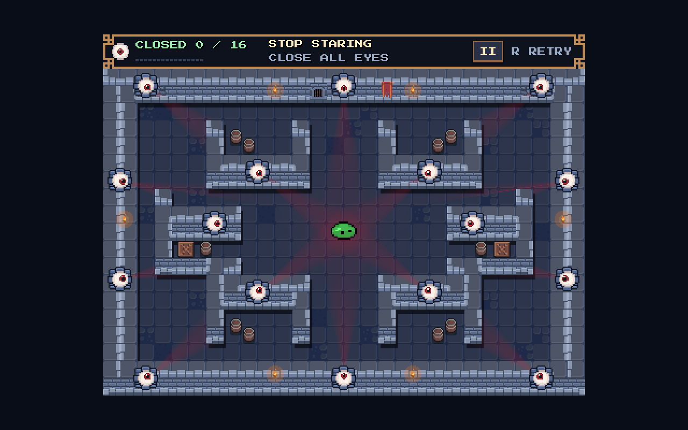
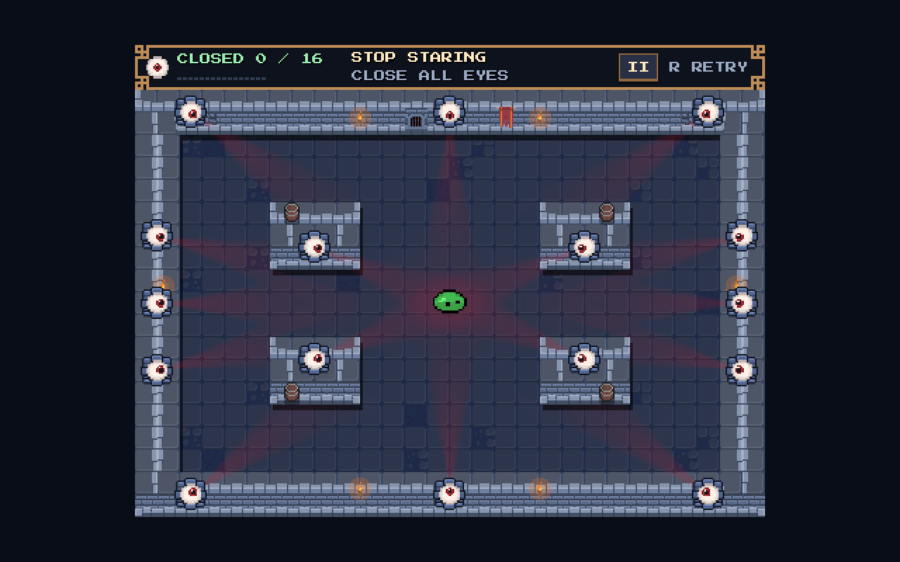

# Four-island arena

The map redesign checkpoint below has since received [scattered crates and extra barrels](../scattered_props/README.md). Island geometry, eye positions and the central cross are unchanged.

The current arena replaces six open alcoves and their thin arms with **four solid 64 × 48 px quadrant islands**. The 448 × 336 px viewport, 384 × 240 px playable boundary, spawn at (224, 184), camera, movement, eye timers and HUD are retained.

The internal wall footprint falls from 98 to 48 tiles. Walkable floor grows from 262 to 312 tiles, about **19% more floor** before accounting for the removed floor props. Every island has a straight, uninterrupted bank-shot face. No inner post, neck, pocket or corridor remains.

## Matched screenshots

Both images are actual native Godot renders in the same 1280 × 800 window at 2× integer scale. The before image loads the task-start arena scene with the same current scripts, art, eye settings and HUD used for the after image. Capturing the old scene did not replace the current project scene.

| Before: six alcoves | After: four solid islands |
|---|---|
|  |  |

[Live movement recording](movement.mp4) shows native mouse input with live CharacterBody2D physics: four launches, ten ricochets and three eyes closed. The recording is 481 frames at 60 fps, approximately eight seconds of video. It is a movement demonstration, not a human difficulty or performance benchmark.

## Geometry and eyes

Coordinates below are world pixels. All gameplay geometry and eye mounts mirror about (224, 184).

| Island | Rectangle (x, y, width, height) | Eye hit origin | Exposed face |
|---|---|---|---|
| Upper left | (96, 112, 64, 48) | (128, 160) | South, toward center |
| Upper right | (288, 112, 64, 48) | (320, 160) | South, toward center |
| Lower left | (96, 208, 64, 48) | (128, 208) | North, toward center |
| Lower right | (288, 208, 64, 48) | (320, 208) | North, toward center |

There are **16 eyes**: three on each perimeter wall (12), plus one on each island (4). The two removed middle-alcove eyes move to left/right perimeter midpoints. Lower side-wall mounts move four pixels to make their vertical spacing exactly mirrored. The sockets retain their existing size, inset, collision-hit tolerance and timer behavior.

| Route | Before | After |
|---|---|---|
| Central vertical gap between paired quadrant structures | 64 px | 128 px |
| Top/bottom outside route at the old arms | 16 px | 48 px |
| Side outside route beside old middle back posts | 16 px | 64 px |
| Cross-arena horizontal route | Interrupted by middle structures | Continuous 48 px band |

The central cross has a 128 × 48 px overlap, with its vertical lane continuing through the arena and its horizontal lane spanning the full playable width. All main gaps are at least 48 px, versus the unchanged 10 px slime collider diameter. The narrow middle-alcove pockets are removed completely.

## Props and preserved systems

Ten barrels become four island-top barrels. Their existing circular colliders are wholly inside the solid island footprints, so they add no extra collision surface to any floor lane. Both crates are removed. Six torches, the wall gate, banner and sparse floor wear remain; no new art is introduced.

The gameplay scripts for the arena, slime, clock, camera, presentation and HUD; slime/eye scenes; presentation scene; UI files; and supplied art resources are unchanged by this layout task. Separate local gaze-opacity and draw-batching edits appeared during the work and were retained. The paired images use the same current rendering settings. [Preservation hashes and measurements](validation.json) distinguish these concurrent edits from the map changes.

Map edits are in `stop_staring/experiments/pixel_pivot/layout.json` and its generated `pixel_arena.tscn`. The existing `tests/regression.gd` now expects four blocks and checks measured lane widths, mirrored eye faces, mirrored physical floor connectivity, fully contained barrel colliders and real mirrored bank shots. Current-layout descriptions are updated in the root README, gameplay README and `docs/pixel_pivot/README.md`. Native tests refresh the existing room and independent-eye captures as well.

## Validation

Godot 4.8.dev6, Compatibility renderer:

| Check | Assertions | Failures |
|---|---:|---:|
| Task-start arena, native baseline | 2366 | 0 |
| Redesigned arena, headless | 2428 | 0 |
| Redesigned arena, native | 2432 | 0 |
| Independent eyes, headless | 230 | 0 |
| Independent eyes, native | 243 | 0 |

The arena fixture floods real circle positions at 4 px spacing through wall and prop collisions, verifies mirrored reachability, and finds physical approaches to all sixteen eyes. All eyes are also closed through actual swept contacts. Maximum-speed corner banks, eight mirrored island-bank routes, launch/re-aim controls, whole-room framing, win and retry pass. Multi-contact mirrored traces allow subpixel physics-solver drift rather than requiring bit-identical floating-point normals.

The independent-eye fixture also passes the live sequence: hit A → aim at 0.25× → hit B later → A alone reopens while moving → immediately close A again → B retains its own deadline. No timer, input or launch parameters are changed.

Native/headless runs retain the existing two ObjectDB cleanup warnings seen in the baseline; the MovieWriter fixture additionally retains scene resources at exit. Assertions and recording checks pass. These teardown diagnostics were not addressed as part of the map redesign.

No remaining one-tile choke or trap pocket was found in collision checks or visual inspection. The **48 px horizontal, top and bottom lanes** are now the tightest routes; their comfort and the 20-second routing challenge still need human playtesting. The scripted complete-clear fixture starts near each target and does not establish a timed human clear.

Rebuild using the existing arena-only path after editing the JSON:

```bash
"$GODOT_BIN" --headless --path stop_staring --script ../tools/build_pixel_pivot.gd -- --arena-only
```
