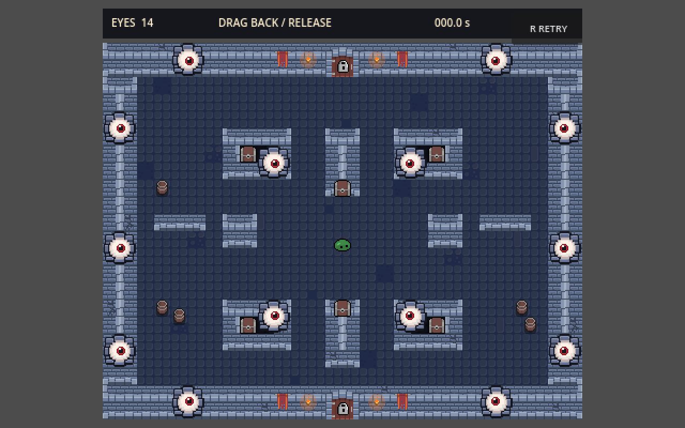
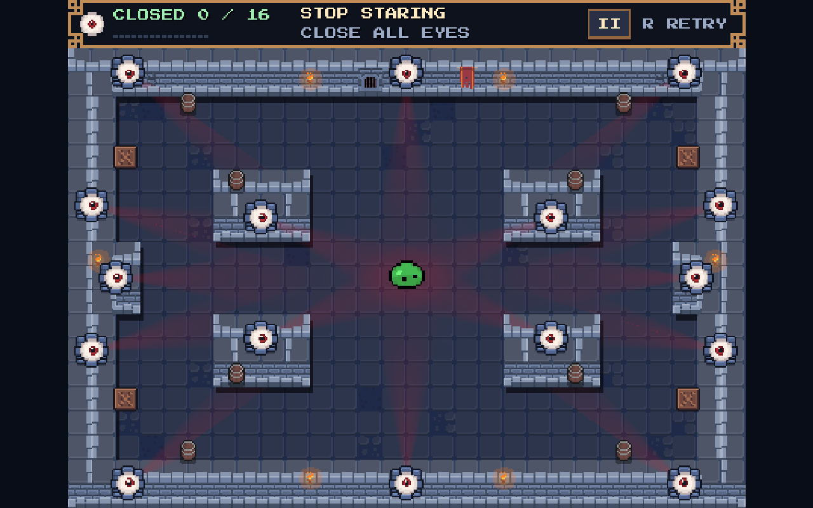
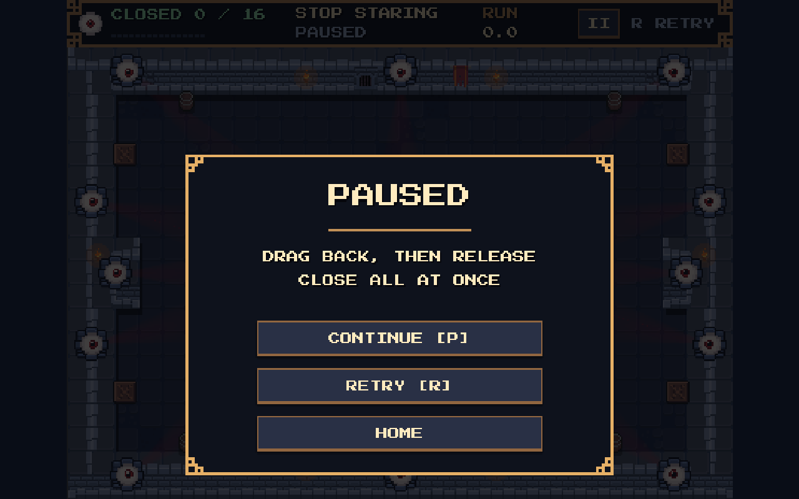
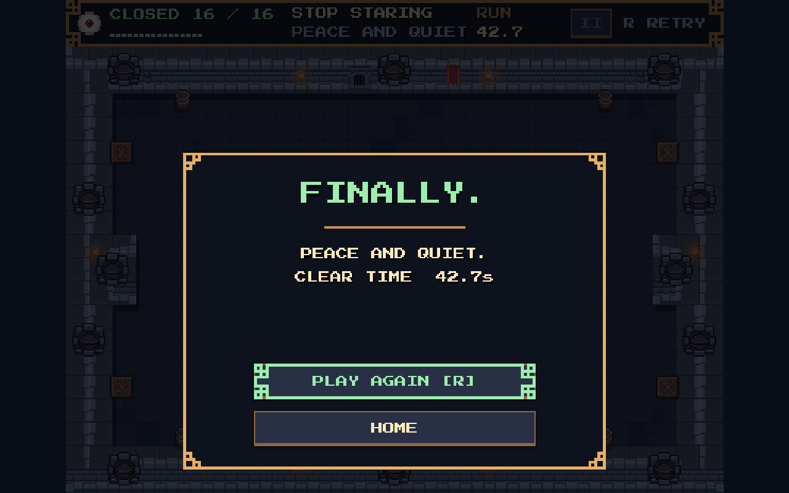
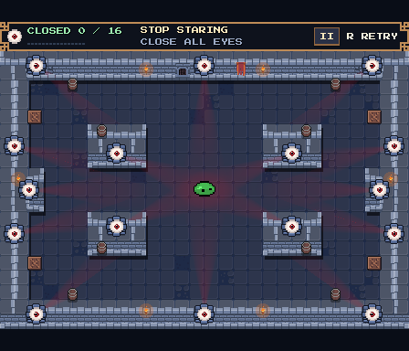
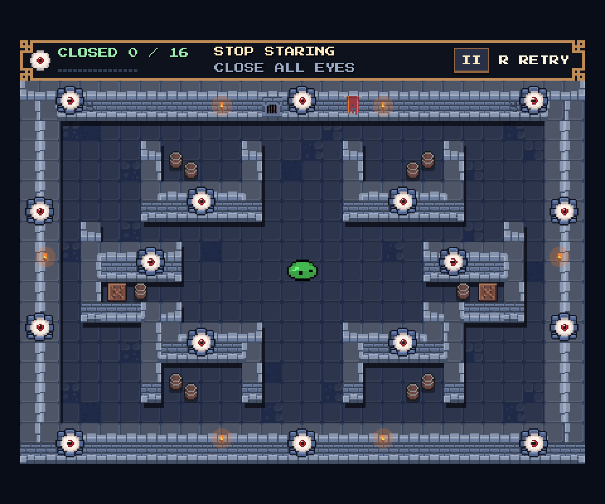

# Retro UI preview

Actual Godot 4.8.dev6 Compatibility runtime captures, rendered at integer
scales from the existing 448 × 384 game view. The before and after views
both use a 1280 × 800 window at 2×. Only the UI and letterbox background
are restyled here; the supplied reference drives the brass, navy and mint
palette.

## Before



## Gameplay



## Pause



## Clear



The fixture sets the displayed 42.7-second result and pops each eye through
its contact API. It does not measure a human completion time. The capture
waits for the existing pop animations to finish.

## Integer scales

Native 1×, 448 × 384:



3× in a 1440 × 1200 window:



## Files and verification

- `stop_staring/ui/retro_theme.tres`: shared pixel font, button states and panels.
- `stop_staring/ui/retro_hud.tscn`: editable HUD and modal layouts.
- `stop_staring/experiments/pixel_pivot/hud.gd`: counter, pips, timer and modal state.
- `stop_staring/experiments/pixel_pivot/arena.gd`: shared pause and continue actions.
- `stop_staring/experiments/pixel_pivot/pixel_arena.tscn`: instances the UI.
- `stop_staring/experiments/pixel_pivot/pixel_pivot.tscn`: dark letterbox backdrop.
- `tools/build_pixel_pivot.gd`: retains the UI scene and backdrop on rebuild.
- `stop_staring/assets/ui/README.md`: asset sources, font settings and licenses.

The existing regression suite passed 2322 checks. The focused native UI
fixture passed 48 checks, including font settings, text fitting, button
containment, native pause/continue/replay input, canceled aim over the HUD,
focus suspension, timer formatting and 1×/3× input mapping.

Regenerating all scenes in an isolated temporary copy also passed the 43
headless UI checks. Repeated headless gameplay runs reported shutdown
warnings for Ogg/MP3 playback resources after rapid synthetic wall contacts.
The native UI run and rebuilt UI fixture exited cleanly; audio was unchanged
in this UI pass.

Run from the repository root with your Godot executable:

```bash
godot --headless --path stop_staring --script res://experiments/pixel_pivot/tests/regression.gd
godot --path stop_staring --script res://experiments/pixel_pivot/tests/retro_ui.gd
```

The second command saves these PNGs. Headless mode checks behavior and
skips image capture. Native rendering was inspected; touch devices and
browser rendering were not validated in this UI pass.
