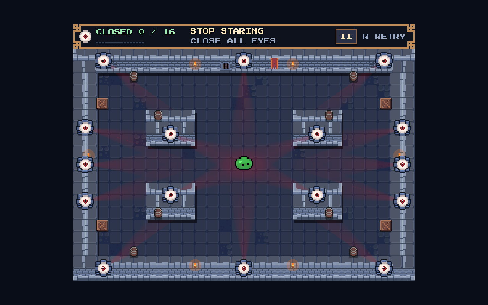
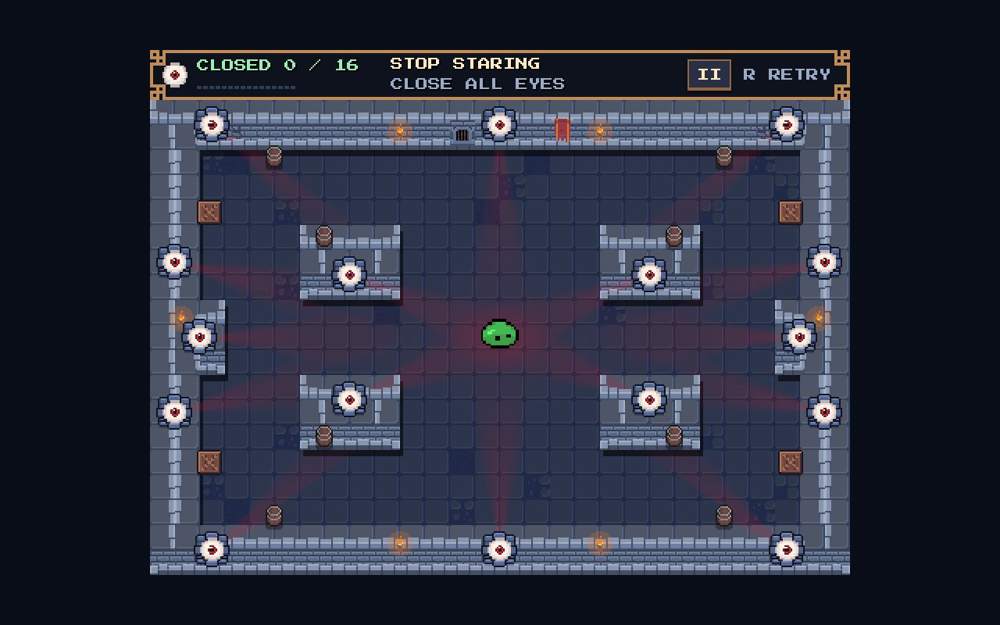

# Side-wall midpoint lips

Added matching **16 px deep × 48 px tall** inward lips at the marked left/right wall midpoints. They are attached to the existing walls, using the same painted tile union and solid wall collisions. The four quadrant islands, eight barrels, four crates, arena bounds and spawn remain unchanged.

| Lip | Physical rectangle (x, y, width, height) | Midpoint eye hit origin |
|---|---|---|
| Left | (32, 160, 16, 48) | (48, 184), facing right |
| Right | (400, 160, 16, 48) | (400, 184), facing left |

The two midpoint eyes move onto the exposed lip faces and retain their existing size and independent timers. There are still sixteen eyes. The open horizontal band between the lips is 352 × 48 px; the vertical center lane remains 128 px wide. Shoulder spacing to the islands is at least 48 px, with no neck or pocket added.

| Before | After |
|---|---|
|  |  |

The existing regression passed **2468 headless checks** and **2472 native checks**, with no assertion failures. Both lips receive actual swept horizontal launch contacts and reflect the slime before the old wall. Mirrored collision connectivity, corner banks, all sixteen physical eye hits, win and retry pass. Native rendering was visually inspected. Existing headless scene-resource teardown warnings remain.

Source: `stop_staring/experiments/pixel_pivot/layout.json`, with a separate `wall_lips` array. The existing arena builder includes that array and regenerates `pixel_arena.tscn`; geometry-dependent regression expectations and the gameplay README are updated. Movement, eye/timer, camera, HUD and presentation scripts/scenes are byte-preserved from the task-start snapshot.
